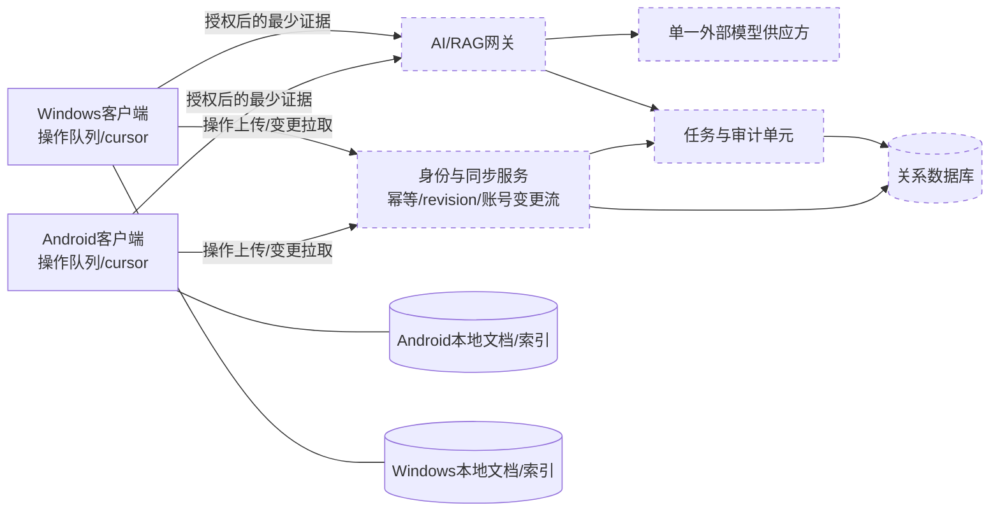
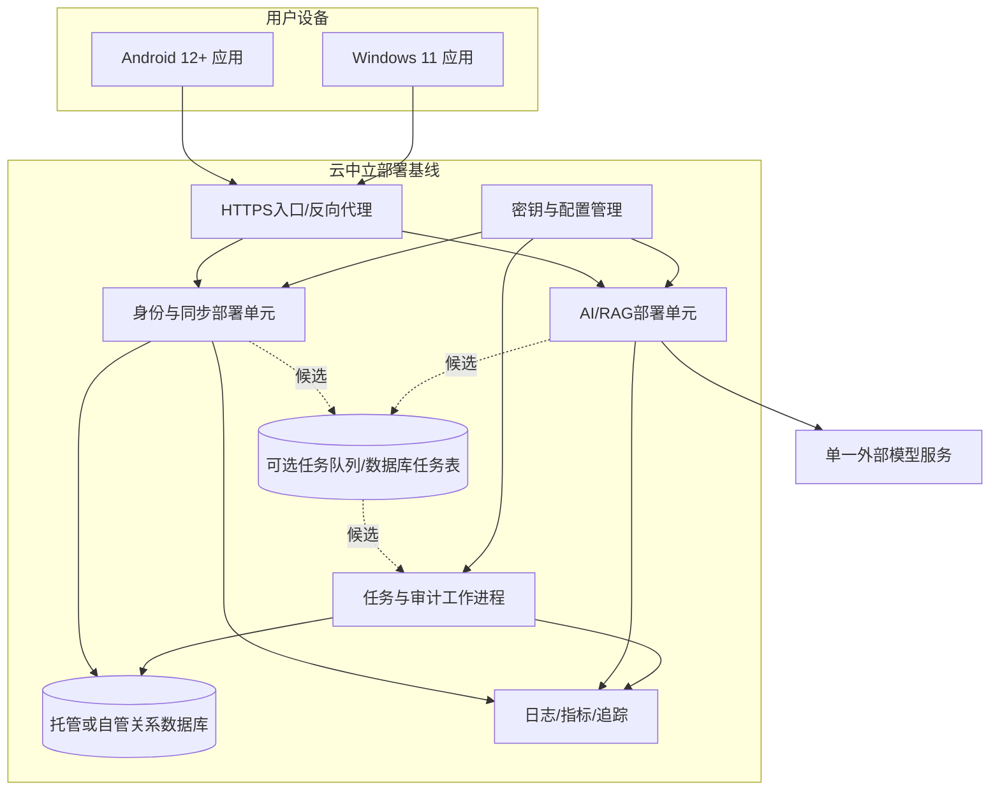

# 智能阅读器拟议架构责任、通信、数据与部署视图

- 版本：V1.2
- 日期：2026-11-17
- 状态：Proposed
- 输入决策：D-11 B、D-12 A、D-13 A、D-14 A、D-15 A、D-16 A、D-17 A、D-18 A、D-19 A、D-20 A、D-21 A
- 禁止解释：本文件不是 D-35 最终部署图，不确定具体数据库、消息中间件、KMP 最终采用、模型供应方或云资源规格。

## 1 拟议责任边界

| 责任单元 | 拟议职责 | 明确不负责 | 主要未决项 |
|---|---|---|---|
| Android客户端 | 文件授权、文档本体、本地解析/索引、阅读UI、笔记、持久化SyncOperation队列和账号cursor、权限与外发同意、引用回跳；凭据进入平台安全存储 | 不把文件本体和全文索引默认上传；重新基线不得清空未确认操作 | D-22、D-23、D-25、D-27、D-31 |
| Windows客户端 | 本地文件访问、文档本体、本地解析/索引、阅读UI、笔记、持久化SyncOperation队列和账号cursor、引用回跳；凭据进入平台安全存储 | 不依赖 Android URI；不与 Android 共享 UI；重新基线不得清空未确认操作 | D-22、D-23、D-25、D-27、D-31 |
| KMP共享核心候选 | 精确哈希与版本规则、SyncOperation与cursor状态机、冲突策略、数据契约、错误语义和测试向量 | 不直接调用平台 UI、文件选择、数据库、安全存储或文档渲染 API | D-27、D-28 |
| 身份与同步服务 | 自建个人账号、设备会话、最小文档身份/版本元数据、进度、笔记、冲突副本、幂等记录、资源revision、tombstone、账号级变更流、syncEpoch和不透明cursor | 不保存文档本体、解析结果或全文索引；不按文件名或路径自动绑定版本；变更流不等于全系统事件总线 | D-27、D-30、D-31 |
| AI/RAG网关 | 校验证据包契约、调用单一模型适配器、流式响应、取消、超时、错误归一化和最少审计 | 不主动访问客户端文档；不绕过客户端权限与同意 | D-24、D-27、D-29、D-31 |
| 任务与审计单元 | 服务端异步任务、重试、tombstone期满清理、结构化审计和诊断 | 不承担同步写入事务或账号变更流的主所有权；不成为原文日志仓库 | D-26、D-30、D-32 |
| 外部模型供应方 | 根据授权证据完成生成 | 不获得本地全文索引或未授权文档范围 | D-29、供应方政策核对 |

## 2 拟议通信边界

| 通信 | 拟议内容 | 安全/一致性要求 | 未决协议 |
|---|---|---|---|
| 客户端→身份同步服务 | 自建账号登录、设备会话、不可变操作上传、账号变更拉取、冲突结果、重新基线和协议协商 | HTTPS、operation id、device id、base revision、不透明cursor、syncEpoch、协议版本；撤销设备后拒绝旧会话 | D-27、D-31 |
| 客户端→AI/RAG网关 | 查询、同意记录、文档版本、裁剪后的最少证据和引用候选 | 权限过滤先于外发；拒绝同意时不得调用模型 | D-24、D-27 |
| AI/RAG网关→模型供应方 | 统一模型请求、最少证据、流式或非流式生成 | 供应方字段隔离、超时、取消、限流和日志脱敏 | D-29 |
| 服务→任务与审计单元 | 异步命令、状态或审计事件 | 幂等、关联ID、不得携带不必要原文 | D-26、D-30、D-32 |
| 客户端本地模块间 | 平台端口、共享核心契约、文档Evidence/Citation对象 | 不把路径/URI/UI对象泄漏进共享核心 | D-22、D-25、D-28 |

公共协议可采用 REST；AI 流式可采用 SSE、WebSocket 或轮询。具体选择必须等待 D-27，当前图中只标记“受控流式通道”。

## 3 拟议数据边界

### 3.1 仅保存在客户端

- 用户授权的文档本体。
- 解析结果、OCR结果、页面图像和全文索引。
- 可还原全文的大规模块数据或向量索引。
- 平台文件授权：Android Content URI、Windows 文件位置与授权状态。
- 阅读缓存、渲染缓存和平台临时文件。

### 3.2 可以进入云端

- 个人账号、设备会话和撤销状态。
- 最小 DocumentIdentity、DocumentVersion、精确内容哈希和显式版本关联元数据；文件名与路径不作为自动绑定依据。
- 阅读进度。
- 服务端可读的用户笔记、受限短摘录、冲突副本及其版本信息；这些均按敏感数据处理并执行字段与长度限制。
- 同步操作、revision、游标、tombstone 和删除传播状态。
- 不含原文的审计、错误、重试和关联标识。

具体字段字典、摘录长度、备份例外和静态加密实现由 D-31 决定；tombstone 采用固定短期保留，但具体天数仍待验证，不能写成正式 SLA。

### 3.3 可以发送给模型供应方

- 仅限用户本次明确同意的文档范围。
- 客户端权限过滤、版本校验和裁剪后的最少证据。
- 查询和完成生成所需的最小上下文。
- 不发送本地全文索引，不默认发送整个文档。

供应方数据区域、留存、训练使用、删除、费用和具体模型由 D-29 核对。

## 4 拟议同步语义

1. 客户端业务修改与不可变 `SyncOperation` 先持久化，再尝试上传；网络失败和响应丢失使用同一 operation id 重试。
2. 服务端在业务写入前校验访问令牌、设备会话和权限，再用 base revision 执行冲突或过期写入判断。
3. 服务端在同一事务中更新资源当前态、追加账号级变更记录并固化幂等结果；不得出现写入成功但变更流不可见。
4. 笔记并发编辑生成冲突副本，不静默覆盖；进度只在同一有效文档版本内按服务端可信顺序选择最新记录。
5. 删除生成 tombstone 及对应变更，旧设备操作不得复活数据。
6. 客户端使用绑定账号与 syncEpoch 的不透明 cursor 拉取；变更先安全落地，再原子保存新 cursor，崩溃后允许重复应用但不得漏变更。
7. tombstone或cursor超过保留窗口时，服务端返回 `REBASE_REQUIRED`；客户端重建远端当前态和cursor，但保留未确认操作队列并在新基线上重新校验。
8. 精确内容哈希相同可以自动匹配；内容变化建立新的 DocumentVersion，只有用户显式确认后才关联原 DocumentIdentity。
9. 协议版本不兼容时明确拒绝或要求升级，不得由旧客户端猜测新字段；具体兼容周期留给D-27。

D-21 A 不要求消息代理或实时推送。账号变更流可由身份与同步服务拥有的关系数据库变更表和单调序号实现；具体保留天数、批次阈值、退避、推送和备份例外仍待 D-27、D-30、D-31 与验证。

## 5 Proposed逻辑视图

图中关系数据库是逻辑能力，不代表已选择具体引擎。同步资源状态、幂等结果和账号变更记录要求同事务，但不要求引入事件总线；任务与审计单元是否需要独立队列由 D-30 决定。

## 6 Proposed部署视图

### 6.1 华为云候选能力映射

| 图中能力 | 候选映射 | 说明 |
|---|---|---|
| 计算部署单元 | ECS 或 CCE | 二选一或组合由实际规模和 D-30 决定 |
| 关系数据库 | RDS | 引擎、规格、备份和迁移尚未选择 |
| 可选任务队列 | DMS 类能力 | 也可能使用数据库任务表；不得为了展示强制引入 |
| 日志与诊断 | LTS及监控/应用性能能力 | 不记录原文、笔记正文、查询证据或密钥 |
| 密钥管理 | DEW/KMS类能力 | 具体密钥和密文边界由 D-31 决定 |

## 7 信任边界

1. 用户设备与云端之间是网络信任边界，所有请求必须认证并加密传输；访问/刷新令牌和设备会话分别受控。
2. 本地文档权限边界早于检索、缓存和 AI 外发。
3. AI/RAG 网关与外部模型供应方之间是第三方数据处理边界。
4. 日志、审计和监控系统不得成为原文或笔记内容的旁路存储。
5. 粗粒度服务之间不得使用共享密钥和共享数据库访问绕过责任边界。
6. 客户端本地数据库、索引和缓存主要受应用沙箱、用户权限和操作系统数据保护；账号凭据必须进入平台安全存储。

## 8 尚未解决的架构问题

- D-22：文档解析与规范化边界。
- D-23：索引与检索实现边界。
- D-25：两端平台适配端口。
- D-27：REST、SSE/WebSocket、错误模型和兼容周期。
- D-28：KMP 验证后的最终共享核心技术栈。
- D-29：具体模型供应方、模型和费用。
- D-30：数据库、队列和缓存实现。
- D-35：最终责任和部署视图冻结。

已关闭方向但仍需细化或验证：D-16 精确匹配与显式版本关联、D-17 最小可读同步载荷、D-18 自建账号与设备会话、D-19 固定短期 tombstone 和异步硬删除、D-20 分层本地存储与平台保护、D-21 操作上传与账号级游标变更流。它们不再作为方案选择问题列出，但相关字段、阈值、协议兼容期和实现仍受后续决策约束。

