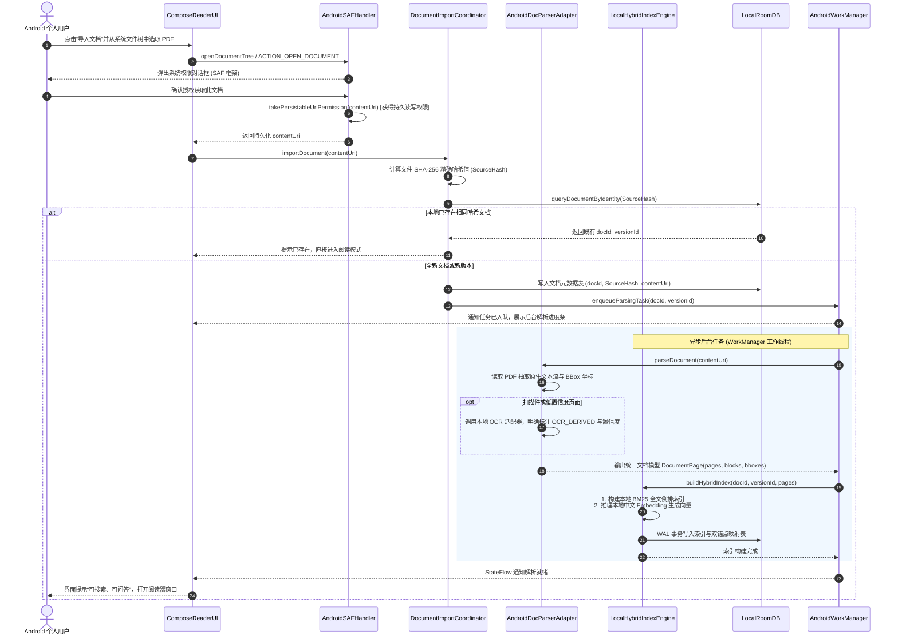
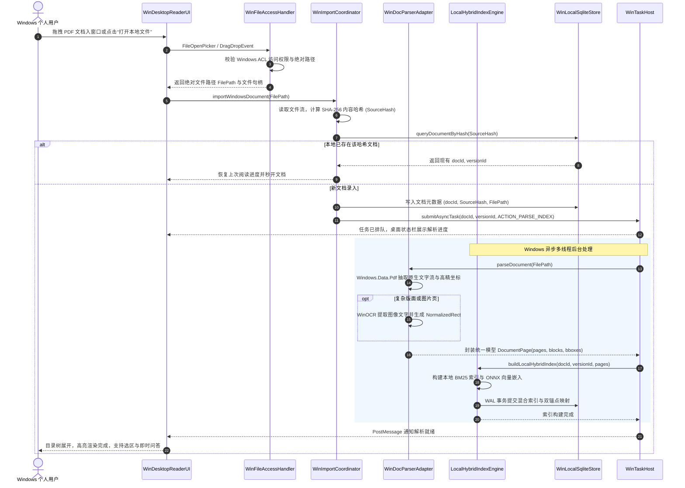
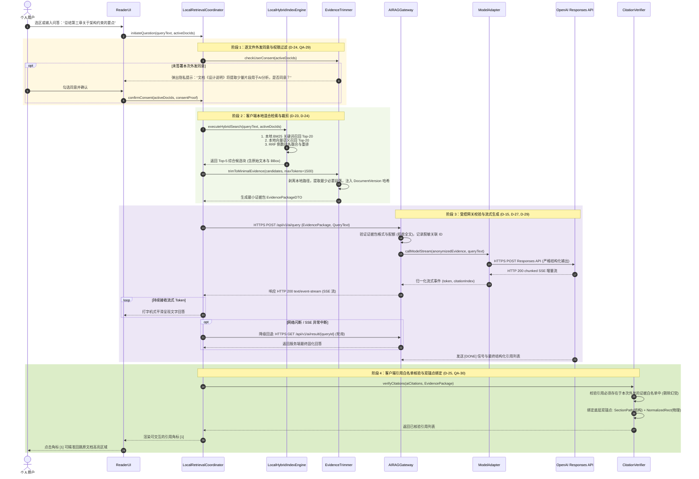
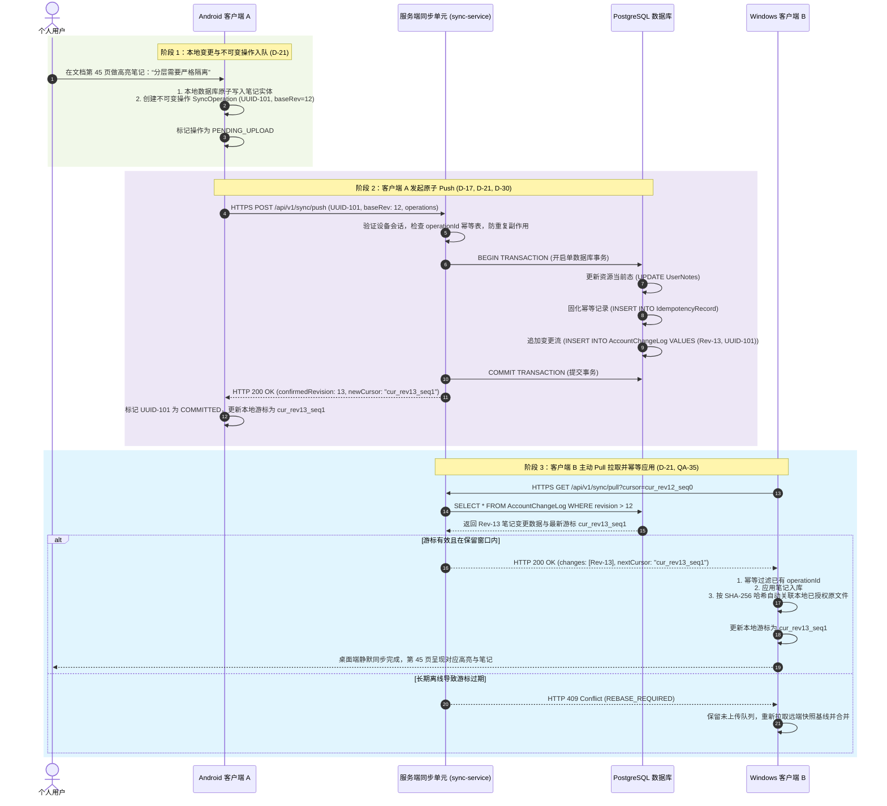
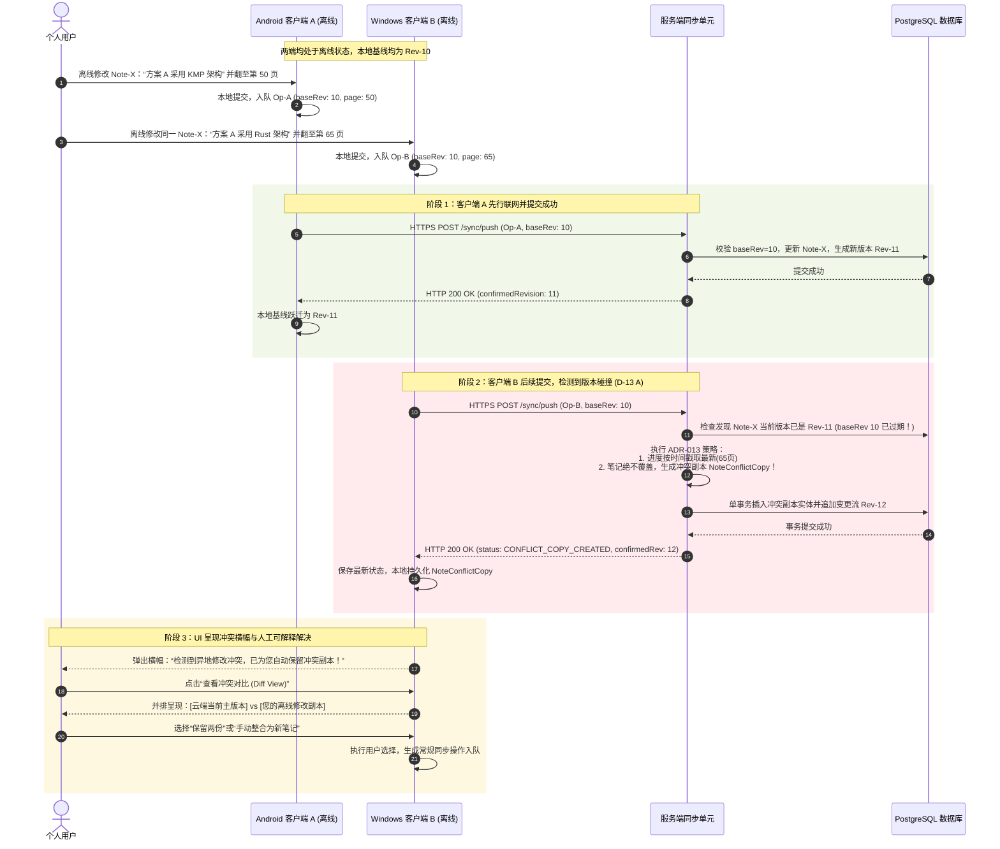
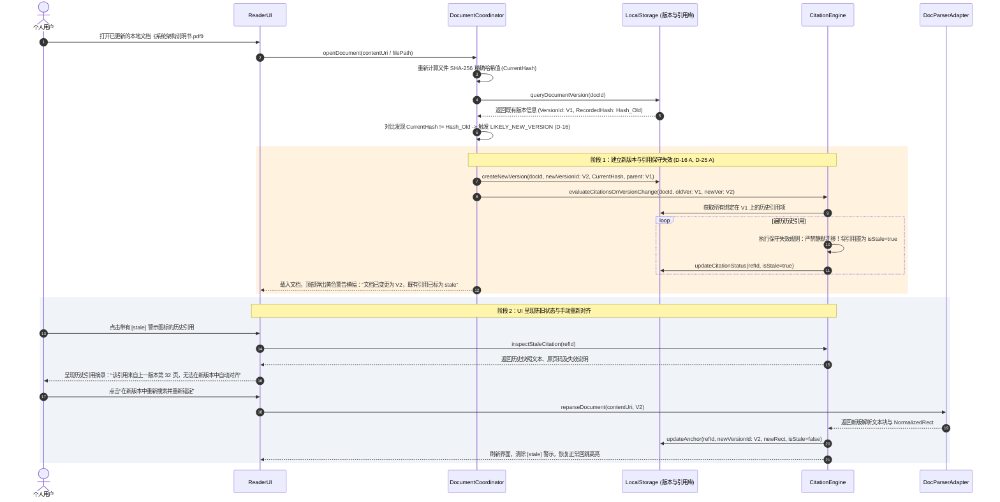
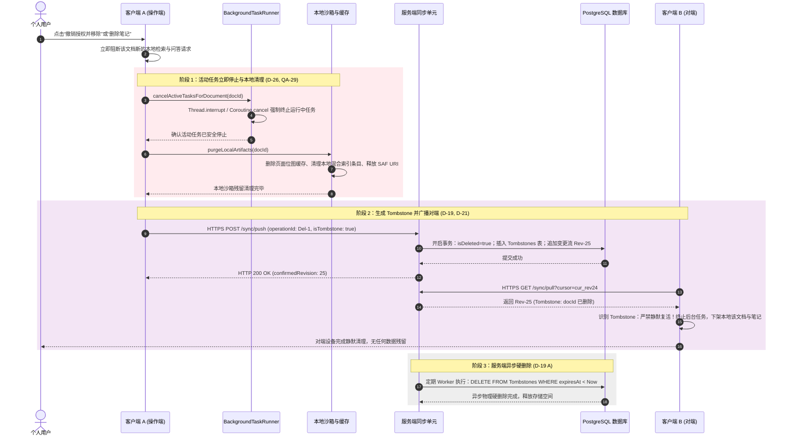
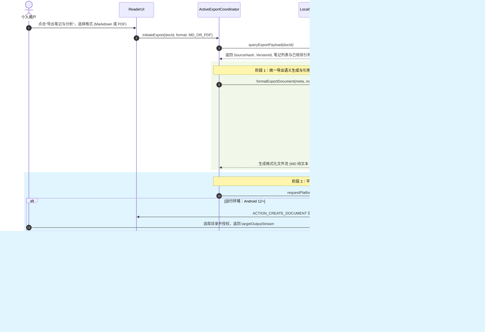

# 智能阅读器架构图件说明与元素字典

- 版本：V1.0
- 日期：2026-11-17
- 负责人：角色 D（架构视图负责人）
- 审核人：角色 A（架构决策与成果集成负责人）、角色 B（Windows 调研）、角色 C（Android 调研）
- 状态：Proposed 正式图件交付包（决策前候选，决策后正式）
- 依据基线：V0.3 正式基线 + V0.4 双端增量输入 + 集中决策清单 V1.6（D-00 至 D-35）+ ADR V1.3 + 设计说明书 V1.1（36）+ 一致性评审记录 V1.0（37）
- 交付物目录：
  - 规范文档：`41-架构图件说明与元素字典-V1.0.md`
  - 可编辑源文件：`41-架构视图与图件交付包-V1.0/底稿-PlantUML/`（包含全部 13 份 `.puml` 底稿）
  - 矢量导出图：`41-架构视图与图件交付包-V1.0/导出图-SVG/`（包含全部 13 份高清矢量 `.svg` 文件）
  - 位图导出图：`41-架构视图与图件交付包-V1.0/导出图-PNG/`（包含全部 13 份 200 DPI `.png` 文件）
  - 文档导出图：`41-架构视图与图件交付包-V1.0/导出图-PDF/`（包含全部 13 份矢量 `.pdf` 文档）

---

## 1 交付物总览与追踪矩阵

本交付包完全闭合角色 D 在四人分工方案中定义的 **D-D01 至 D-D07** 全部交付职责，并全面响应《37-架构图件一致性评审记录-V1.0》中的初始问题清单（VIS-001 至 VIS-010）。

| 交付物编号 | 图件编号与名称 | UML 类型 | 状态要求 | 关联决策 | 关联质量场景 / UC | 源文件与导出图链接 |
|---|---|---|---|---|---|---|
| **D-D01** | ARCH-01 系统上下文与信任边界图 | 上下文协作图 | 正式图 (Proposed) | D-01, D-05, D-09, D-15, D-17, D-23, D-24 | QA-29, QA-36 | [PUML](file:///D:/北航事务/大三上/软分/软分项目/Intelligent-Reader/docs/架构设计/阶段成果-V0.4-双端需求补充/41-架构视图与图件交付包-V1.0/底稿-PlantUML/ARCH-01-系统上下文与信任边界图.puml) \| [SVG](file:///D:/北航事务/大三上/软分/软分项目/Intelligent-Reader/docs/架构设计/阶段成果-V0.4-双端需求补充/41-架构视图与图件交付包-V1.0/导出图-SVG/ARCH-01-系统上下文与信任边界图.svg) \| [PNG](file:///D:/北航事务/大三上/软分/软分项目/Intelligent-Reader/docs/架构设计/阶段成果-V0.4-双端需求补充/41-架构视图与图件交付包-V1.0/导出图-PNG/ARCH-01-系统上下文与信任边界图.png) \| [PDF](file:///D:/北航事务/大三上/软分/软分项目/Intelligent-Reader/docs/架构设计/阶段成果-V0.4-双端需求补充/41-架构视图与图件交付包-V1.0/导出图-PDF/ARCH-01-系统上下文与信任边界图.pdf) |
| **D-D02** | ARCH-02 逻辑架构图 | 逻辑分层与包依赖图 | 正式图 (Proposed) | D-03, D-11, D-12, D-22, D-28, D-35 | QA-33, QA-40 | [PUML](file:///D:/北航事务/大三上/软分/软分项目/Intelligent-Reader/docs/架构设计/阶段成果-V0.4-双端需求补充/41-架构视图与图件交付包-V1.0/底稿-PlantUML/ARCH-02-逻辑架构图.puml) \| [SVG](file:///D:/北航事务/大三上/软分/软分项目/Intelligent-Reader/docs/架构设计/阶段成果-V0.4-双端需求补充/41-架构视图与图件交付包-V1.0/导出图-SVG/ARCH-02-逻辑架构图.svg) \| [PNG](file:///D:/北航事务/大三上/软分/软分项目/Intelligent-Reader/docs/架构设计/阶段成果-V0.4-双端需求补充/41-架构视图与图件交付包-V1.0/导出图-PNG/ARCH-02-逻辑架构图.png) \| [PDF](file:///D:/北航事务/大三上/软分/软分项目/Intelligent-Reader/docs/架构设计/阶段成果-V0.4-双端需求补充/41-架构视图与图件交付包-V1.0/导出图-PDF/ARCH-02-逻辑架构图.pdf) |
| **D-D03** | ARCH-03 进程与通信边界图 | 进程并发与通信构件图 | 正式图 (Proposed) | D-11, D-21, D-26, D-27, D-30 | QA-31, QA-32, QA-35 | [PUML](file:///D:/北航事务/大三上/软分/软分项目/Intelligent-Reader/docs/架构设计/阶段成果-V0.4-双端需求补充/41-架构视图与图件交付包-V1.0/底稿-PlantUML/ARCH-03-进程与通信边界图.puml) \| [SVG](file:///D:/北航事务/大三上/软分/软分项目/Intelligent-Reader/docs/架构设计/阶段成果-V0.4-双端需求补充/41-架构视图与图件交付包-V1.0/导出图-SVG/ARCH-03-进程与通信边界图.svg) \| [PNG](file:///D:/北航事务/大三上/软分/软分项目/Intelligent-Reader/docs/架构设计/阶段成果-V0.4-双端需求补充/41-架构视图与图件交付包-V1.0/导出图-PNG/ARCH-03-进程与通信边界图.png) \| [PDF](file:///D:/北航事务/大三上/软分/软分项目/Intelligent-Reader/docs/架构设计/阶段成果-V0.4-双端需求补充/41-架构视图与图件交付包-V1.0/导出图-PDF/ARCH-03-进程与通信边界图.pdf) |
| **D-D04a** | ARCH-04a 候选部署图·云中立基线 | 部署图 (Node/Artifact) | 候选图 (Proposed) | D-08, D-11, D-14, D-35 | QA-39, QA-40 | [PUML](file:///D:/北航事务/大三上/软分/软分项目/Intelligent-Reader/docs/架构设计/阶段成果-V0.4-双端需求补充/41-架构视图与图件交付包-V1.0/底稿-PlantUML/ARCH-04a-候选部署图-云中立基线.puml) \| [SVG](file:///D:/北航事务/大三上/软分/软分项目/Intelligent-Reader/docs/架构设计/阶段成果-V0.4-双端需求补充/41-架构视图与图件交付包-V1.0/导出图-SVG/ARCH-04a-候选部署图-云中立基线.svg) \| [PNG](file:///D:/北航事务/大三上/软分/软分项目/Intelligent-Reader/docs/架构设计/阶段成果-V0.4-双端需求补充/41-架构视图与图件交付包-V1.0/导出图-PNG/ARCH-04a-候选部署图-云中立基线.png) \| [PDF](file:///D:/北航事务/大三上/软分/软分项目/Intelligent-Reader/docs/架构设计/阶段成果-V0.4-双端需求补充/41-架构视图与图件交付包-V1.0/导出图-PDF/ARCH-04a-候选部署图-云中立基线.pdf) |
| **D-D04b** | ARCH-04b 候选部署图·华为云能力映射 | 部署图 (Cloud Mapping) | 候选图 (Proposed) | D-14, D-35 | QA-39, QA-40 | [PUML](file:///D:/北航事务/大三上/软分/软分项目/Intelligent-Reader/docs/架构设计/阶段成果-V0.4-双端需求补充/41-架构视图与图件交付包-V1.0/底稿-PlantUML/ARCH-04b-候选部署图-华为云能力映射.puml) \| [SVG](file:///D:/北航事务/大三上/软分/软分项目/Intelligent-Reader/docs/架构设计/阶段成果-V0.4-双端需求补充/41-架构视图与图件交付包-V1.0/导出图-SVG/ARCH-04b-候选部署图-华为云能力映射.svg) \| [PNG](file:///D:/北航事务/大三上/软分/软分项目/Intelligent-Reader/docs/架构设计/阶段成果-V0.4-双端需求补充/41-架构视图与图件交付包-V1.0/导出图-PNG/ARCH-04b-候选部署图-华为云能力映射.png) \| [PDF](file:///D:/北航事务/大三上/软分/软分项目/Intelligent-Reader/docs/架构设计/阶段成果-V0.4-双端需求补充/41-架构视图与图件交付包-V1.0/导出图-PDF/ARCH-04b-候选部署图-华为云能力映射.pdf) |
| **D-D05-1** | FLOW-01 Android文档选择授权解析与本地索引 | 时序图 (Sequence) | 正式图 (Proposed) | D-05, D-20, D-22, D-23, D-26 | UC01, UC02, QA-27, QA-28 | [PUML](file:///D:/北航事务/大三上/软分/软分项目/Intelligent-Reader/docs/架构设计/阶段成果-V0.4-双端需求补充/41-架构视图与图件交付包-V1.0/底稿-PlantUML/FLOW-01-Android文档选择授权解析与本地索引.puml) \| [SVG](file:///D:/北航事务/大三上/软分/软分项目/Intelligent-Reader/docs/架构设计/阶段成果-V0.4-双端需求补充/41-架构视图与图件交付包-V1.0/导出图-SVG/FLOW-01-Android文档选择授权解析与本地索引.svg) \| [PNG](file:///D:/北航事务/大三上/软分/软分项目/Intelligent-Reader/docs/架构设计/阶段成果-V0.4-双端需求补充/41-架构视图与图件交付包-V1.0/导出图-PNG/FLOW-01-Android文档选择授权解析与本地索引.png) \| [PDF](file:///D:/北航事务/大三上/软分/软分项目/Intelligent-Reader/docs/架构设计/阶段成果-V0.4-双端需求补充/41-架构视图与图件交付包-V1.0/导出图-PDF/FLOW-01-Android文档选择授权解析与本地索引.pdf) |
| **D-D05-2** | FLOW-02 Windows文档选择访问解析与本地索引 | 时序图 (Sequence) | 正式图 (Proposed) | D-02, D-05, D-20, D-22, D-23, D-26 | UC01, UC02, QA-27, QA-28 | [PUML](file:///D:/北航事务/大三上/软分/软分项目/Intelligent-Reader/docs/架构设计/阶段成果-V0.4-双端需求补充/41-架构视图与图件交付包-V1.0/底稿-PlantUML/FLOW-02-Windows文档选择访问解析与本地索引.puml) \| [SVG](file:///D:/北航事务/大三上/软分/软分项目/Intelligent-Reader/docs/架构设计/阶段成果-V0.4-双端需求补充/41-架构视图与图件交付包-V1.0/导出图-SVG/FLOW-02-Windows文档选择访问解析与本地索引.svg) \| [PNG](file:///D:/北航事务/大三上/软分/软分项目/Intelligent-Reader/docs/架构设计/阶段成果-V0.4-双端需求补充/41-架构视图与图件交付包-V1.0/导出图-PNG/FLOW-02-Windows文档选择访问解析与本地索引.png) \| [PDF](file:///D:/北航事务/大三上/软分/软分项目/Intelligent-Reader/docs/架构设计/阶段成果-V0.4-双端需求补充/41-架构视图与图件交付包-V1.0/导出图-PDF/FLOW-02-Windows文档选择访问解析与本地索引.pdf) |
| **D-D05-3** | FLOW-03 本地混合检索最少证据选择与AI问答引用核验 | 时序图 (Sequence) | 正式图 (Proposed) | D-06, D-15, D-24, D-25, D-27, D-29 | UC03, UC04, QA-29, QA-30, QA-32, QA-34 | [PUML](file:///D:/北航事务/大三上/软分/软分项目/Intelligent-Reader/docs/架构设计/阶段成果-V0.4-双端需求补充/41-架构视图与图件交付包-V1.0/底稿-PlantUML/FLOW-03-本地混合检索最少证据选择与AI问答引用核验.puml) \| [SVG](file:///D:/北航事务/大三上/软分/软分项目/Intelligent-Reader/docs/架构设计/阶段成果-V0.4-双端需求补充/41-架构视图与图件交付包-V1.0/导出图-SVG/FLOW-03-本地混合检索最少证据选择与AI问答引用核验.svg) \| [PNG](file:///D:/北航事务/大三上/软分/软分项目/Intelligent-Reader/docs/架构设计/阶段成果-V0.4-双端需求补充/41-架构视图与图件交付包-V1.0/导出图-PNG/FLOW-03-本地混合检索最少证据选择与AI问答引用核验.png) \| [PDF](file:///D:/北航事务/大三上/软分/软分项目/Intelligent-Reader/docs/架构设计/阶段成果-V0.4-双端需求补充/41-架构视图与图件交付包-V1.0/导出图-PDF/FLOW-03-本地混合检索最少证据选择与AI问答引用核验.pdf) |
| **D-D05-4** | FLOW-04 双端阅读进度与笔记同步时序图 | 时序图 (Sequence) | 正式图 (Proposed) | D-04, D-17, D-21, D-30 | UC05, QA-31, QA-35 | [PUML](file:///D:/北航事务/大三上/软分/软分项目/Intelligent-Reader/docs/架构设计/阶段成果-V0.4-双端需求补充/41-架构视图与图件交付包-V1.0/底稿-PlantUML/FLOW-04-双端阅读进度与笔记同步时序图.puml) \| [SVG](file:///D:/北航事务/大三上/软分/软分项目/Intelligent-Reader/docs/架构设计/阶段成果-V0.4-双端需求补充/41-架构视图与图件交付包-V1.0/导出图-SVG/FLOW-04-双端阅读进度与笔记同步时序图.svg) \| [PNG](file:///D:/北航事务/大三上/软分/软分项目/Intelligent-Reader/docs/架构设计/阶段成果-V0.4-双端需求补充/41-架构视图与图件交付包-V1.0/导出图-PNG/FLOW-04-双端阅读进度与笔记同步时序图.png) \| [PDF](file:///D:/北航事务/大三上/软分/软分项目/Intelligent-Reader/docs/架构设计/阶段成果-V0.4-双端需求补充/41-架构视图与图件交付包-V1.0/导出图-PDF/FLOW-04-双端阅读进度与笔记同步时序图.pdf) |
| **D-D05-5** | FLOW-05 离线并发修改同步冲突与冲突保留处理时序图 | 时序图 (Sequence) | 正式图 (Proposed) | D-13, D-21 | UC05, QA-35 | [PUML](file:///D:/北航事务/大三上/软分/软分项目/Intelligent-Reader/docs/架构设计/阶段成果-V0.4-双端需求补充/41-架构视图与图件交付包-V1.0/底稿-PlantUML/FLOW-05-离线并发修改同步冲突与冲突保留处理时序图.puml) \| [SVG](file:///D:/北航事务/大三上/软分/软分项目/Intelligent-Reader/docs/架构设计/阶段成果-V0.4-双端需求补充/41-架构视图与图件交付包-V1.0/导出图-SVG/FLOW-05-离线并发修改同步冲突与冲突保留处理时序图.svg) \| [PNG](file:///D:/北航事务/大三上/软分/软分项目/Intelligent-Reader/docs/架构设计/阶段成果-V0.4-双端需求补充/41-架构视图与图件交付包-V1.0/导出图-PNG/FLOW-05-离线并发修改同步冲突与冲突保留处理时序图.png) \| [PDF](file:///D:/北航事务/大三上/软分/软分项目/Intelligent-Reader/docs/架构设计/阶段成果-V0.4-双端需求补充/41-架构视图与图件交付包-V1.0/导出图-PDF/FLOW-05-离线并发修改同步冲突与冲突保留处理时序图.pdf) |
| **D-D05-6** | FLOW-06 文档版本变化引用失效(stale)与重新授权时序图 | 时序图 (Sequence) | 正式图 (Proposed) | D-16, D-25 | UC02, UC04, QA-30 | [PUML](file:///D:/北航事务/大三上/软分/软分项目/Intelligent-Reader/docs/架构设计/阶段成果-V0.4-双端需求补充/41-架构视图与图件交付包-V1.0/底稿-PlantUML/FLOW-06-文档版本变化引用失效stale与重新授权时序图.puml) \| [SVG](file:///D:/北航事务/大三上/软分/软分项目/Intelligent-Reader/docs/架构设计/阶段成果-V0.4-双端需求补充/41-架构视图与图件交付包-V1.0/导出图-SVG/FLOW-06-文档版本变化引用失效stale与重新授权时序图.svg) \| [PNG](file:///D:/北航事务/大三上/软分/软分项目/Intelligent-Reader/docs/架构设计/阶段成果-V0.4-双端需求补充/41-架构视图与图件交付包-V1.0/导出图-PNG/FLOW-06-文档版本变化引用失效stale与重新授权时序图.png) \| [PDF](file:///D:/北航事务/大三上/软分/软分项目/Intelligent-Reader/docs/架构设计/阶段成果-V0.4-双端需求补充/41-架构视图与图件交付包-V1.0/导出图-PDF/FLOW-06-文档版本变化引用失效stale与重新授权时序图.pdf) |
| **D-D05-7** | FLOW-07 文件撤权删除传播活动任务停止与残留清理时序图 | 时序图 (Sequence) | 正式图 (Proposed) | D-05, D-19, D-20, D-26 | UC05, QA-29, QA-31 | [PUML](file:///D:/北航事务/大三上/软分/软分项目/Intelligent-Reader/docs/架构设计/阶段成果-V0.4-双端需求补充/41-架构视图与图件交付包-V1.0/底稿-PlantUML/FLOW-07-文件撤权删除传播活动任务停止与残留清理时序图.puml) \| [SVG](file:///D:/北航事务/大三上/软分/软分项目/Intelligent-Reader/docs/架构设计/阶段成果-V0.4-双端需求补充/41-架构视图与图件交付包-V1.0/导出图-SVG/FLOW-07-文件撤权删除传播活动任务停止与残留清理时序图.svg) \| [PNG](file:///D:/北航事务/大三上/软分/软分项目/Intelligent-Reader/docs/架构设计/阶段成果-V0.4-双端需求补充/41-架构视图与图件交付包-V1.0/导出图-PNG/FLOW-07-文件撤权删除传播活动任务停止与残留清理时序图.png) \| [PDF](file:///D:/北航事务/大三上/软分/软分项目/Intelligent-Reader/docs/架构设计/阶段成果-V0.4-双端需求补充/41-架构视图与图件交付包-V1.0/导出图-PDF/FLOW-07-文件撤权删除传播活动任务停止与残留清理时序图.pdf) |
| **D-D05-8** | FLOW-08 Markdown与PDF主动导出及版本引用保留时序图 | 时序图 (Sequence) | 正式图 (Proposed) | D-01, D-10, D-22, D-25 | UC06, QA-27, QA-30 | [PUML](file:///D:/北航事务/大三上/软分/软分项目/Intelligent-Reader/docs/架构设计/阶段成果-V0.4-双端需求补充/41-架构视图与图件交付包-V1.0/底稿-PlantUML/FLOW-08-Markdown与PDF主动导出及版本引用保留时序图.puml) \| [SVG](file:///D:/北航事务/大三上/软分/软分项目/Intelligent-Reader/docs/架构设计/阶段成果-V0.4-双端需求补充/41-架构视图与图件交付包-V1.0/导出图-SVG/FLOW-08-Markdown与PDF主动导出及版本引用保留时序图.svg) \| [PNG](file:///D:/北航事务/大三上/软分/软分项目/Intelligent-Reader/docs/架构设计/阶段成果-V0.4-双端需求补充/41-架构视图与图件交付包-V1.0/导出图-PNG/FLOW-08-Markdown与PDF主动导出及版本引用保留时序图.png) \| [PDF](file:///D:/北航事务/大三上/软分/软分项目/Intelligent-Reader/docs/架构设计/阶段成果-V0.4-双端需求补充/41-架构视图与图件交付包-V1.0/导出图-PDF/FLOW-08-Markdown与PDF主动导出及版本引用保留时序图.pdf) |
| **D-D06** | 架构图件说明与元素字典 | 规范文档 | 正式文档 (Active) | 全量 D-00 至 D-35 | 全量 AD / QA | 本文档正文第 2 至第 5 节 |
| **D-D07** | 图件源文件及导出图交付包 | 多格式资产 | 正式资产包 (Complete) | 全量 | 全量 | 包含 13 个 PUML、13 个 SVG、13 个 PNG、13 个 PDF |

---

## 2 架构图件说明与一致性字典

为彻底解决《37-架构图件一致性评审记录-V1.0》提出的 **VIS-003（逻辑单元、进程与部署服务混淆）** 问题，建立以下全系统统一元素字典。

### 2.1 参与者与主体 (Actors)

| 元素标识 | 统一中文名 | 归属与边界 | 说明与约束 |
|---|---|---|---|
| `PersonalUser` | 个人用户 | 外部物理参与者 | 一期仅面向个人单用户本地工作区。**严格排除团队成员、组织协作、公开分享者或独立管理员角色 (D-09)**。 |

### 2.2 客户端逻辑与代码组件 (Client Components)

| 元素标识 | 统一中文名 | 分层归属 | 平台与共享边界 |
|---|---|---|---|
| `ComposeReaderScreen` | Android 阅读交互壳 | 表现层 (Android) | 基于 Jetpack Compose 实现，处理移动端手势选区、目录导航与状态呈现。 |
| `WinDesktopReaderWindow` | Windows 桌面阅读壳 | 表现层 (Windows) | 基于 Windows 桌面窗口机制，处理多窗口阅读、拖放与快捷键交互。 |
| `AndroidSAFHandler` | Android SAF 框架适配器 | 平台适配层 (Android) | 负责调用 Storage Access Framework，获得并持久化 Content URI (`takePersistableUriPermission`)。 |
| `WinFileAccessHandler` | Windows 文件访问适配器 | 平台适配层 (Windows) | 负责调用 Win32 FileOpenPicker 对话框与拖放事件，校验本地 ACL 路径权限。 |
| `DocumentImportCoordinator` | 文档接入协调器 | 应用编排层 | 编排文档哈希计算、去重匹配、异步任务注册与版本绑定。 |
| `LocalRetrievalCoordinator` | 本地检索与问答协调器 | 应用编排层 | 驱动本地 BM25 与向量模型召回，执行 RRF 融合重排与证据裁剪。 |
| `EvidenceTrimmer` | 最少证据裁剪器 | 应用编排层 | 校验用户逐文件同意签名，过滤无关上下文，生成符合 Token 预算的不可逆证据包。 |
| `CitationVerifier` | 引用核验与锚点绑定器 | 应用编排层 | 负责将模型返回的引用下标与发出的证据白名单比对，剔除幻觉引用并绑定双锚点。 |
| `LocalHybridIndexEngine` | 本地混合检索引擎 | 平台适配层 | 端侧执行分词倒排建库 (BM25) 与轻量 Embedding 向量化，**索引资产严格留存在端侧 (D-23)**。 |
| `AndroidDocParserAdapter` | Android 文档解析适配器 | 平台适配层 (Android) | 基于 PdfRenderer/AndroidX 成熟组件抽取页面文字与 BBox，扫描件按需路由至 OCR。 |
| `WinDocParserAdapter` | Windows 文档解析适配器 | 平台适配层 (Windows) | 基于 Windows.Data.Pdf 提取页面文字树与 BBox，扫描件按需路由至 WinOCR。 |
| `AndroidKeystoreAdapter` | Android 硬件凭据适配器 | 平台适配层 (Android) | 封装 Android Keystore，硬件级加密持久化用户访问令牌与设备会话。 |
| `WinCredentialAdapter` | Windows 凭据管理器适配器 | 平台适配层 (Windows) | 封装 Windows DPAPI 与 Credential Manager，安全保护本地令牌。 |
| `AndroidWorkManager` | Android 任务调度器 | 平台适配层 (Android) | 基于 WorkManager 保证进程回收或断网重启后的任务持久可恢复执行。 |
| `WinTaskHost` | Windows 任务宿主 | 平台适配层 (Windows) | 桌面应用线程池与任务持久化状态机，保障长任务崩溃后恢复。 |

### 2.3 KMP 共享领域实体与合同 (Candidate Shared Core Domain)

> **严禁污染准则 (D-03, D-12, D-28)**：以下实体和接口必须完全纯粹，禁止引用 Android SDK、Win32 API、UI 框架、SQLite 驱动或网络框架。

| 实体 / 合同标识 | 统一中文名 | 作用与生命周期 | 字段规范与语义 |
|---|---|---|---|
| `DocumentIdentity` | 文档身份实体 | 逻辑身份标识 | `docId: UUID`；`sourceHash: String` (文档内容 SHA-256)；用于跨设备精确匹配。 |
| `DocumentVersion` | 文档版本实体 | 不可变版本快照 | `versionId: UUID`；`parserVersion: String`；内容变化必须创建新版本并显式关联父版本。 |
| `CitationAnchor` | 引用双锚点实体 | 溯源锚点绑定 | 包含：1. 结构锚点 `SectionPath` (大纲章节路径)；2. 物理/字符锚点 `NormalizedRect` + `TextRange`。 |
| `StaleMarker` | 陈旧失效标记 | 引用状态注记 | 当文档内容哈希变动生成新版本时，旧引用默认标记 `isStale = true`，严禁静默迁移。 |
| `SyncOperation` | 不可变同步操作 | 客户端同步队列实体 | `operationId: UUID`；`baseRevision: Long`；`syncEpoch: Long`；`payload: JSON` (仅结构化元数据)。 |
| `SyncState` | 同步引擎状态机 | 游标与同步态管理 | 包含当前不透明游标 `cursor`、未同步操作队列、以及 `REBASE_REQUIRED` 异常处理逻辑。 |
| `NoteConflictCopy` | 笔记冲突副本 | 冲突一等公民实体 | 并发冲突时不猜测用户意图，保留对端修改为独立冲突副本，通过 UI 提供 Diff 并行解决。 |
| `EvidencePackageDTO` | 统一最少证据包 | 端云通信数据契约 | 仅含授权短摘录文本、页码范围、DocumentVersion 哈希及同意证明，**严禁包含原文档全文**。 |
| `DocumentPage` | 统一归一化文档页 | 跨端文档处理合同 | `pages`, `blocks`, `NormalizedRect(x,y,w,h, [0..1])`, `CapabilitySet`, `DegradationReason`。 |

### 2.4 服务端逻辑责任单元与组件 (Server Units & Components)

> **粗粒度解耦准则 (D-11, D-35)**：服务端由三个高内聚逻辑单元组成，一期在物理上允许同机/同节点部署，共同依托 PostgreSQL 保证事务一致性。

| 单元 / 进程标识 | 统一中文名 | 职责范围 | 明确不负责 (负向边界) |
|---|---|---|---|
| `sync-service` | 个人身份与同步单元 | 账号鉴权、设备会话、最小元数据、进度、笔记、冲突副本、单事务 revision 递增与游标变更流。 | **绝对不保存文档本体、页面位图、OCR 结果或全文/向量索引**。 |
| `rag-gateway` | AI/RAG 网关单元 | 证据包合同校验、Token 长度配额限制、ModelAdapter 隔离调用、SSE 增量响应与轮询回退。 | **不主动读取客户端文件、不私自检索、不扩大授权证据范围**。 |
| `task-worker` | 后台任务与审计单元 | 基于 PostgreSQL 任务表进行 lease 争顶领取、指数退避重试、过期墓碑清理与内容无关审计。 | **不拥有同步事务写入权、不保存任何明文日志**。 |
| `ModelAdapter` | 模型供应商隔离适配器 | 屏蔽 OpenAI Responses API 专有结构，实现流式输出归一化与统一错误码转换。 | **不泄漏外部模型专有数据类型进入业务领域核心**。 |

### 2.5 数据存储分类与留存边界字典 (Data Boundary Dictionary)

| 数据类别 | 客户端沙箱 | 服务端 PostgreSQL | 外部模型供应商 | 隐私与合规控制准则 |
|---|---|---|---|---|
| **文档本体 (PDF/DOCX/MD)** | 持久保存 (原位置/授权) | **绝对禁止** | **绝对禁止** | D-05, D-17: 绝不上移云端，仅在各端本地沙箱与授权目录下处理。 |
| **页面位图与 OCR 识别流** | 私有缓存保存 | **绝对禁止** | **绝对禁止** | D-20, D-22: 缓存与私有数据库隔离，撤权后立即执行清理。 |
| **全文 BM25 索引与向量索引** | 持久保存 (本地 SQLite) | **绝对禁止** | **绝对禁止** | D-23, D-24: 混合检索 100% 端侧算力执行，向量资产严禁上传。 |
| **平台文件路径与 SAF URI** | 本地分端保存 | **绝对禁止** | **绝对禁止** | D-20, D-31: 平台私有句柄不进入 KMP 共享核心，更不得上云。 |
| **文档身份与版本哈希** | 保存 | 保存不可逆哈希 (无正文) | **仅脱敏引用 ID** | D-16: 基于 SHA-256 建立精准比对，服务端不可逆还原。 |
| **阅读进度与笔记内容** | 保存 | 仅保存同步范围结构化数据 | 仅单次授权证据短摘录 | D-04, D-17: 笔记含原文摘录，按潜在敏感数据受控存储。 |
| **不可变变更流与 Tombstone** | 待上传队列 / 游标 | 持久化变更日志与墓碑 | **绝对禁止** | D-19, D-21: 墓碑在到期前用于阻止旧数据复活，期满硬删除。 |
| **调用日志与可观测指标** | 内容无关诊断包 (用户主动) | 结构化耗时、状态码、错误类 | 供应商协议约束 (待 D-29) | D-31, D-32: 日志白名单严禁记录正文、笔记、令牌与完整路径。 |

---

## 3 架构视图详细说明与图件展示

### 3.1 D-D01: ARCH-01 系统上下文与信任边界图 (正式图)

#### 3.1.1 视图目的与设计意图
展示智能阅读器系统与外部用户、操作系统底层服务、云端计算基础设施及第三方模型供应商之间的顶层边界关系。核心目标在于**明确定义三大信任边界 (Trust Boundaries)**，并以严密的负向约束证明系统践行“本地优先、云端最小化、最少证据外发”原则。

#### 3.1.2 边界与安全控制说明
1. **信任边界 TB-1（客户端私有沙箱边界）**：源文件、解析树、高精 BBox 坐标及本地混合索引 100% 封闭在 Android 12+ / Windows 11 本地应用沙箱内，拒绝任何隐式云端渗漏。
2. **信任边界 TB-2（端云 HTTPS/TLS 1.3 通信边界）**：端云之间仅交换个人账号会话、最小同步操作元数据与已获用户逐文件同意的最少证据包。
3. **信任边界 TB-3（外部供应商隔离边界）**：通过 ModelAdapter 隔离外部 OpenAI 候选服务，单次问答只发送裁剪后的证据短摘录，彻底杜绝本地文件与全文索引外发。

#### 3.1.3 内嵌交互式 Mermaid 图件
```mermaid
flowchart TB
    subgraph External_Users["外部参与者"]
        User["个人用户 (Personal User)<br/>[单用户本地工作区 / 无团队角色]"]
    end

    subgraph Client_Host["客户端受信任宿主环境 (Android 12+ / Windows 11)"]
        direction TB
        subgraph OS_Services["操作系统平台与安全服务"]
            OS_File["平台文件框架<br/>(Android SAF / Win Storage Access)"]
            OS_Sec["平台安全存储<br/>(Keystore / Credential Manager)"]
        end

        subgraph Client_App["智能阅读器客户端应用 (双端分立UI + KMP共享核心)"]
            UI_Shell["分端阅读器与交互壳<br/>(Compose / Win Desktop UI)"]
            Doc_Adapter["分端成熟文档组件与 OCR 适配器<br/>(PdfRenderer / Win.Data.Pdf + Paddle/Tesseract)"]
            Local_Retr["本地混合检索与证据选择引擎<br/>(BM25/全文 + 中文向量模型)"]
            KMP_Core["KMP 共享领域与同步核心<br/>(DocumentIdentity/Version, SyncState, Rules)"]
            Local_Store["本地持久化与任务队列<br/>(SQLite / Room WAL 事务)"]
        end

        subgraph Client_Data["客户端专有数据资产 [严禁离开设备]"]
            Data_Files[("文档本体与页面位图 (PDF/DOCX/MD)")]
            Data_OCR[("解析文本树、OCR 识别流与高精 BBox")]
            Data_Index[("本地 BM25 倒排索引与中文向量索引")]
            Data_Cache[("排版缓存、未外发笔记与草稿")]
        end
    end

    subgraph Server_Host["项目后端服务 (云中立基线 / 课程一期可同机部署)"]
        direction TB
        Edge_Ingress["HTTPS 反向代理入口<br/>(TLS 1.3 / 端口 443 / 限流路由)"]
        
        subgraph Server_Units["三个粗粒度逻辑服务单元 (D-11, D-35)"]
            Svc_Sync["身份与同步单元 (sync-service)<br/>[REST push/pull, revision, cursor]"]
            Svc_AI["AI / RAG 网关单元 (rag-gateway)<br/>[证据包校验, 长度配额, SSE/轮询]"]
            Svc_Worker["任务与审计单元 (task-worker)<br/>[PostgreSQL lease 抢占调度]"]
        end

        subgraph Server_DB["PostgreSQL 关系数据库 [服务端最小数据]"]
            DB_Data[("账号与设备会话表<br/>文档身份哈希映射表 (无正文)<br/>同步进度、笔记与冲突副本表<br/>AccountChangeLog 游标变更流<br/>异步任务表与内容无关审计表")]
        end
    end

    subgraph Ext_Vendor["外部受控模型基础设施 (OpenAI 候选)"]
        Model_Adapter["ModelAdapter 隔离适配器<br/>[屏蔽厂商专有 SDK / 错误归一化]"]
        Ext_LLM["gpt-5.4-mini-2026-03-17<br/>(Responses API 候选固定快照)"]
    end

    %% 跨边界交互
    User -->|本地阅读/选区/问答/导出| UI_Shell
    User -.->|系统弹窗授权| OS_File
    UI_Shell <-->|持久授权句柄/安全凭据| OS_Services
    UI_Shell --> Doc_Adapter
    Doc_Adapter --> Client_Data
    Doc_Adapter --> Local_Retr
    Local_Retr --> Data_Index
    UI_Shell --> Local_Retr
    UI_Shell --> KMP_Core
    KMP_Core --> Local_Store

    %% TB-2 网络边界
    Client_App ==>|信任边界 TB-2: HTTPS (TLS 1.3)<br/>1. 结构化同步元数据 (push/pull)<br/>2. 授权最少证据包 (REST/SSE)| Edge_Ingress
    Edge_Ingress --> Svc_Sync
    Edge_Ingress --> Svc_AI
    Svc_Sync --> DB_Data
    Svc_AI --> DB_Data
    Svc_Worker --> DB_Data

    %% TB-3 模型隔离边界
    Svc_AI ==>|信任边界 TB-3: 外部隔离<br/>单次 Prompt + 授权短摘录<br/>严禁全篇/文档外发| Model_Adapter
    Model_Adapter --> Ext_LLM
    Ext_LLM -->|结构化流式生成 + 引用标识| Model_Adapter
    Model_Adapter --> Svc_AI
```

---

### 3.2 D-D02: ARCH-02 逻辑架构图 (正式图)

#### 3.2.1 视图目的与设计意图
采用 UML 5 层逻辑分层模型（表现与交互层、应用编排层、领域与合同层、平台适配与驱动层、基础设施与平台层），清晰展现系统内部的职责划分与依赖倒置（Dependency Inversion）机制。重点突出 **KMP 共享核心候选（Candidate Shared Core）的纯洁性**，证明平台能力与稳定业务规则之间的严格解耦。

#### 3.2.2 逻辑分层与纯度约束
- **表现层**：Android Compose 与 Windows 桌面分立实现，严格遵循各平台交互习惯与窗口管理规范。
- **编排层**：分为客户端 Coordinator 与服务端 UseCase，负责具体业务用例的编排与装配。
- **领域层**：KMP 共享核心封装全部不可变模型与抽象端口（Ports），严禁泄漏任何平台句柄、UI 状态、SQLite 驱动或后台线程调度类型。
- **适配层**：两端分别实现文档处理、OCR、安全存储与本地持久化驱动；服务端适配 PostgreSQL 与 OpenAI Responses API。

#### 3.2.3 内嵌交互式 Mermaid 图件
```mermaid
flowchart TB
    subgraph Layer1["第 1 层：表现与交互层 (Presentation & Interaction Layer)"]
        direction LR
        subgraph L1_And["Android 表现子系统"]
            UI_And_Reader["ComposeReaderScreen<br/>(阅读与选区高亮)"]
            UI_And_SAF["SAFFilePickerHandler<br/>(系统授权选择入口)"]
            UI_And_Conf["AndroidConflictView<br/>(冲突副本对比呈现)"]
        end
        subgraph L1_Win["Windows 表现子系统"]
            UI_Win_Reader["WinDesktopReaderWindow<br/>(多窗口阅读视图)"]
            UI_Win_File["WinFileAccessHandler<br/>(拖放与文件对话框)"]
            UI_Win_Conf["WinConflictView<br/>(桌面冲突差异呈现)"]
        end
    end

    subgraph Layer2["第 2 层：应用编排层 (Application Orchestration Layer)"]
        direction LR
        subgraph L2_Client["客户端应用编排 (Coordinators)"]
            Coord_Import["DocumentImportCoordinator<br/>(文档接入与版本识别)"]
            Coord_Retr["LocalRetrievalCoordinator<br/>(混合检索与证据裁剪)"]
            Coord_RAG["RAGInteractionCoordinator<br/>(逐次授权与流式降级)"]
            Coord_Sync["SyncQueueCoordinator<br/>(离线队列与周期同步)"]
            Coord_Export["ActiveExportCoordinator<br/>(统一导出语义编排)"]
        end
        subgraph L2_Server["服务端应用用例 (UseCases)"]
            UC_Auth["AccountSessionUseCase<br/>(个人身份与会话管理)"]
            UC_Sync["SyncTransactionUseCase<br/>(原子变更流与游标事务)"]
            UC_AI["EvidenceValidationUseCase<br/>(证据包合同与配额校验)"]
            UC_Task["TaskSchedulerUseCase<br/>(Lease 抢占与故障恢复)"]
        end
    end

    subgraph Layer3["第 3 层：领域与公共契约层 (Domain & Contract Layer)"]
        direction LR
        subgraph L3_KMP["KMP 共享核心领域候选 (Candidate Shared Core) [纯 Kotlin / 零平台依赖]"]
            Dom_Doc["DocumentIdentity / DocumentVersion<br/>(UUID, SourceHash, 显式版本关联)"]
            Dom_Cit["CitationAnchor / StaleMarker<br/>(SectionPath, NormalizedRect, stale状态)"]
            Dom_Sync["SyncOperation / SyncState / ConflictPolicy<br/>(不可变操作队列, 游标状态机, 冲突策略)"]
            Ports_Core["领域抽象端口 (Ports)<br/>IDocumentParserPort / ILocalStoragePort / ISecureStorePort"]
        end
        subgraph L3_Server["服务端领域契约"]
            Dom_Srv["AccountChangeLogEntry / Tombstone<br/>AsyncTaskRecord (lease, attempt, state)<br/>EvidencePackageDTO / UnifiedErrorEnvelope"]
        end
    end

    subgraph Layer4["第 4 层：平台适配与驱动层 (Platform Adaptation Layer)"]
        direction LR
        subgraph L4_And["Android 专有适配器"]
            Adp_And_Doc["PdfRendererAdapter / PaddleOCR"]
            Adp_And_Sec["AndroidKeystoreAdapter"]
            Adp_And_Task["AndroidWorkManagerAdapter"]
            Adp_And_DB["AndroidRoomStorageAdapter"]
        end
        subgraph L4_Win["Windows 专有适配器"]
            Adp_Win_Doc["WinDocRendererAdapter / WinOCR"]
            Adp_Win_Sec["WinCredentialAdapter (DPAPI)"]
            Adp_Win_Task["WinTaskHostAdapter"]
            Adp_Win_DB["WinSqliteStorageAdapter"]
        end
        subgraph L4_Srv["服务端驱动与外部适配器"]
            Adp_Srv_PG["PostgresSyncRepo / PostgresTaskRepo"]
            Adp_Srv_AI["OpenAIModelAdapter (Responses API)"]
        end
    end

    subgraph Layer5["第 5 层：基础设施与平台层 (Infrastructure Layer)"]
        direction LR
        Infra_Client[("客户端沙箱私有目录 / SQLite WAL 引擎 / 本地向量模型权重")]
        Infra_Server[("PostgreSQL 16 数据库 / Linux OS (ECS/CCE) / LTS 日志 / KMS 密钥")]
        Infra_External[("OpenAI API 官方端点 / TLS 1.3 传输链路")]
    end

    %% 分层调用与依赖倒置
    Layer1 --> Layer2
    Layer2 --> Layer3
    Layer4 -.->|依赖倒置实现 (Implements)| Ports_Core
    Layer2 --> Layer4
    Layer4 --> Layer5
```

---

### 3.3 D-D03: ARCH-03 进程与通信边界图 (正式图)

#### 3.3.1 视图目的与设计意图
展现智能阅读器运行时的操作系统进程拓扑、并发线程模型、进程内通信（IPC）、网络协议栈以及错误隔离机制。解决多进程与服务端单元部署时通信语义不明确的风险。

#### 3.3.2 关键通信协议与故障隔离策略
1. **端侧并发**：Android 主线程驱动 Compose 渲染，IO 协程池执行文档解析与混合检索，WorkManager 线程调度后台同步任务，通过 SQLite WAL 事务隔离。Windows 桌面线程类似。
2. **端云网络协议**：
   - 身份与同步：基于 HTTPS POST/GET 传输版本化 REST/JSON，携带 `operationId`、`baseRevision` 与不透明 `cursor`。
   - AI 问答：基于 HTTPS POST 请求，服务端响应 `text/event-stream` (SSE) 流式传输。
3. **断流与降级防护 (D-27)**：若网络闪断导致 SSE 意外中断，系统**绝对禁止凭借客户端不完整片段进行模糊拼接**，而是立即基于 `queryId` 降级为 HTTP 轮询最终结果；同步游标失效时服务端返回 `REBASE_REQUIRED`，保障未确认本地修改不丢失。

#### 3.3.3 内嵌交互式 Mermaid 图件
```mermaid
flowchart TB
    subgraph Android_OS["Android 操作系统运行环境"]
        subgraph Proc_Android["进程: com.reader.android (独立应用沙箱)"]
            Th_And_UI["Main UI 线程<br/>(Compose 交互与渲染)"]
            Th_And_IO["协程池 / IO 线程<br/>(PDF解析、OCR与混合索引)"]
            Th_And_WM["WorkManager 线程<br/>(后台持久任务调度)"]
            DB_And["本地 SQLite/Room<br/>(WAL 事务日志)"]
            
            Th_And_UI <-->|StateFlow / Channel| Th_And_IO
            Th_And_IO <-->|函数调用| DB_And
            Th_And_WM <-->|持久操作存取| DB_And
        end
        Daemon_Keystore["Keystore 守护进程"]
        Th_And_UI -.->|Binder IPC| Daemon_Keystore
    end

    subgraph Windows_OS["Windows 11 操作系统运行环境"]
        subgraph Proc_Win["进程: IntelligentReader.exe (桌面应用进程)"]
            Th_Win_UI["UI 线程<br/>(桌面消息循环)"]
            Th_Win_Tasks["ThreadPool 工作线程<br/>(PDF解析、OCR与混合索引)"]
            Th_Win_Host["TaskHost 持久任务线程<br/>(后台维护与同步队列)"]
            DB_Win["本地 SQLite 数据库<br/>(WAL 事务日志)"]
            
            Th_Win_UI <-->|Task / Await 回调| Th_Win_Tasks
            Th_Win_Tasks <-->|函数调用| DB_Win
            Th_Win_Host <-->|持久操作存取| DB_Win
        end
        Daemon_DPAPI["LSASS / DPAPI 服务"]
        Th_Win_UI -.->|Win32 API 调用| Daemon_DPAPI
    end

    subgraph Server_Host["服务端宿主计算节点 (一期可同机部署多个独立进程)"]
        direction TB
        subgraph Proc_Ingress["进程 1: HTTPS Ingress 代理"]
            Proxy["TLS 终结、限流与反向路由"]
        end

        subgraph Proc_Sync["进程 2: sync-service"]
            Sync_EP["REST API 接入端点"]
            Sync_SM["SyncStateMachine<br/>(单事务协调与冲突判定)"]
            Sync_EP --> Sync_SM
        end

        subgraph Proc_AI["进程 3: rag-gateway"]
            AI_Val["证据包校验与脱敏审计"]
            AI_SSE["SSE 流控制器与轮询回退"]
            AI_ModelAdp["ModelAdapter"]
            AI_Val --> AI_SSE --> AI_ModelAdp
        end

        subgraph Proc_Worker["进程 4: task-worker"]
            Worker_Lease["TaskLeaseManager<br/>(基于 DB lease 抢占)"]
            Worker_Exec["IdempotentExecutor<br/>(幂等执行与失败重试)"]
            Worker_Lease --> Worker_Exec
        end

        subgraph Proc_PG["进程 5: postgresql (PostgreSQL 16 数据库集群)"]
            PG_DB[("PostgreSQL 引擎<br/>• 账号与当前态表<br/>• AccountChangeLog 变更流表<br/>• AsyncTask 任务表 (leaseOwner, leaseUntil)")]
        end

        Proxy -->|本地 Socket / HTTP| Sync_EP
        Proxy -->|本地 Socket / HTTP| AI_Val
        Sync_SM -->|TCP 5432 单事务原子写入| PG_DB
        AI_Val -->|TCP 5432 审计与指标写入| PG_DB
        Worker_Lease -->|TCP 5432 SELECT FOR UPDATE SKIP LOCKED| PG_DB
    end

    subgraph Ext_Cloud["外部模型端点"]
        OpenAI_API["api.openai.com<br/>(Responses API 候选快照)"]
    end

    %% 网络跨边界调用
    Th_And_WM ==>|HTTPS POST/GET (push/pull)| Proxy
    Th_Win_Host ==>|HTTPS POST/GET (push/pull)| Proxy
    Th_And_IO ==>|HTTPS POST (最少证据包) + SSE 流| Proxy
    Th_Win_Tasks ==>|HTTPS POST (最少证据包) + SSE 流| Proxy
    AI_ModelAdp ==>|HTTPS POST (Responses API 结构化调用)| OpenAI_API
```

---

### 3.4 D-D04: ARCH-04a / 04b 候选部署图 (决策前候选，决策后正式)

#### 3.4.1 候选部署图说明与冻结条件 (D-14, D-35)
根据 ADR-014 与 ADR-035，当前处于**候选部署图（Proposed Deployment Diagram）**状态。三个逻辑单元（`sync-service`、`rag-gateway`、`task-worker`）在课程一期允许同机部署，以控制项目构建、单机运行与验证成本。

**向正式部署图（Accepted）跃迁的关闭门槛**：
1. Android 12+ 与 Windows 11 干净环境构建与无残留卸载测试通过。
2. 真实 PostgreSQL 单机及主备容灾备份恢复演练通过。
3. 真实压力测试证明同机部署无严重的 CPU/内存死锁或争用；若产生瓶颈，则触发拆分。

#### 3.4.2 内嵌交互式 Mermaid 图件 (ARCH-04a 云中立基线)
```mermaid
flowchart TB
    subgraph Device_Android["用户手持移动终端 <<device>> Android 12+"]
        subgraph Env_And["Android OS 沙箱运行环境"]
            Art_APK["IntelligentReader.apk<br/><<executable package>><br/>[签名 release 侧载包]"]
            Store_And[("应用私有目录文件存储<br/>• 本地 SQLite 数据库<br/>• 本地 BM25 与向量索引资产")]
            Art_APK --> Store_And
        end
    end

    subgraph Device_Windows["用户桌面办公终端 <<device>> Windows 11 PC"]
        subgraph Env_Win["Windows 11 桌面运行环境"]
            Art_EXE["IntelligentReader-win-x64<br/><<executable package>><br/>[绿色演示包 / 安装包]"]
            Store_Win[("AppData/Local 本地目录<br/>• 本地 SQLite 数据库<br/>• 本地 BM25 与向量索引资产")]
            Art_EXE --> Store_Win
        end
    end

    subgraph Node_Linux["云中立计算节点 <<node>> 标准 Linux 主机 (Ubuntu 22.04 LTS / 容器宿主) [一期同机验证基线]"]
        direction TB
        subgraph Env_Proxy["反向代理网关 <<executionEnvironment>>"]
            Art_Proxy["Caddy / Nginx<br/>[TLS 1.3 终结 / 443 监听 / 路由限流]"]
        end

        subgraph Env_Java["Java 21 / 容器运行时 <<executionEnvironment>>"]
            Art_Sync["sync-service.jar<br/>(8081 / HTTP 本地监听)"]
            Art_AI["rag-gateway.jar<br/>(8082 / HTTP 本地监听)"]
            Art_Worker["task-worker.jar<br/>(后台任务抢占调度器)"]
        end

        subgraph Env_DB["数据库系统 <<database system>>"]
            Art_PG[("PostgreSQL 16 Engine<br/>• intelligent_reader_db<br/>• 同步当前态与变更流<br/>• 异步任务表与 lease 锁")]
        end

        subgraph Env_Support["安全配置与内容无关可观测 <<support>>"]
            Art_Secret["安全环境变量注入<br/>(OS Secret / .env 隔离配置)"]
            Art_Obs["内容无关指标与日志收集<br/>(Prometheus Exporter + Fluentbit)"]
        end

        Art_Proxy -->|127.0.0.1:8081| Art_Sync
        Art_Proxy -->|127.0.0.1:8082| Art_AI
        Art_Sync -->|TCP 5432 单事务提交| Art_PG
        Art_AI -->|TCP 5432 审计日志| Art_PG
        Art_Worker -->|TCP 5432 Lease 抢占| Art_PG

        Art_Secret -.-> Art_Sync
        Art_Secret -.-> Art_AI
        Art_Secret -.-> Art_Worker
        Art_Sync -.-> Art_Obs
        Art_AI -.-> Art_Obs
        Art_Worker -.-> Art_Obs
    end

    subgraph Cloud_OpenAI["外部模型供应商 <<node>> OpenAI Cloud Platform"]
        Art_OpenAI["Responses API Endpoint<br/>(gpt-5.4-mini-2026-03-17 候选模型)"]
    end

    %% 网络拓扑
    Art_APK ==>|HTTPS 443 (TLS 1.3)| Art_Proxy
    Art_EXE ==>|HTTPS 443 (TLS 1.3)| Art_Proxy
    Art_AI ==>|HTTPS 443 (Responses API)| Art_OpenAI
```

#### 3.4.3 华为云商业产品能力映射矩阵 (ARCH-04b 对照)

| 云中立能力标准 | 华为云对应候选产品 | 架构约束与映射准则 (D-14, 36设计说明书第23节) |
|---|---|---|
| **弹性计算与容器** | **ECS 弹性云服务器 / CCE 云容器引擎** | 仅作为宿主算力映射，业务代码完全容器化或基于标准 jar 运行，严禁依赖华为云特有 API。 |
| **高可用关系数据库** | **RDS for PostgreSQL (16版本)** | 提供免运维的主备双活、自动快照备份与 WAL 归档，满足 D-30 单事务原子性要求。 |
| **可观测性与日志** | **LTS 云日志服务 + AOM 应用运维管理** | 严格限制为内容无关调用日志白名单（耗时、状态码、错误类），严禁采集文档正文或完整路径。 |
| **密钥与安全管理** | **DEW 数据加密服务 / KMS 密钥管理** | 仅用于服务端启动时注入数据库密码与模型 API Key，不侵入端侧共享核心代码。 |

---

### 3.5 D-D05: FLOW-01 至 FLOW-08 关键运行场景图

以下 8 个关键运行场景覆盖了阅读器完整生命周期中的所有核心用例、负向边界与异常降级分支。

#### 3.5.1 FLOW-01: Android 文档选择、授权、解析与本地混合索引
- **关联需求与质量**：UC01, UC02, D-05, D-20, D-22, D-23, D-26 | QA-27, QA-28 | ADR-022, ADR-023。
- **运行特征**：基于 Android Storage Access Framework (SAF) 取得持久读取权限，计算 SHA-256 精确哈希，后台通过 WorkManager 调用 PdfRenderer 提取文字与高精 BBox 坐标；遇到扫描文档或模糊页面显式调用本地 OCR，输出带来源与置信度标记的 `DocumentPage`；端侧构建本地 BM25 倒排索引与固定中文 Embedding 向量库。



---

#### 3.5.2 FLOW-02: Windows 文档选择、访问、解析与本地混合索引
- **关联需求与质量**：UC01, UC02, D-02, D-05, D-20, D-22, D-23, D-26 | QA-27, QA-28 | ADR-022, ADR-023。
- **运行特征**：Windows 11 桌面端支持拖放与 Win32 文件对话框，校验绝对路径 ACL 权限并计算 SHA-256 哈希；利用 `Windows.Data.Pdf` 抽取页面文本及双精度 BBox；遇扫描文档由 Windows OCR 适配器处理，本地构建 BM25 与 ONNX 中文向量索引，整个过程完全在 AppData 本地沙箱进行，绝不上云。



---

#### 3.5.3 FLOW-03: 本地混合检索、最少证据选择、AI 问答与引用核验
- **关联需求与质量**：UC03, UC04, D-06, D-15, D-24, D-25, D-27, D-29 | QA-29, QA-30, QA-32, QA-34 | ADR-024, ADR-025, ADR-027, ADR-029。
- **运行特征**：
  1. **逐文件同意**：发起模型请求前强制校验用户外发授权，未授权文档弹出隐私确认框。
  2. **本地混合检索**：在客户端执行 BM25 与向量模型双路召回（Top-20），经 RRF 融合重排后，严格裁剪为小于 1500 Tokens 的最小证据包 `EvidencePackageDTO`。
  3. **流式与降级**：通过 HTTPS 发往网关，ModelAdapter 调用 OpenAI Responses API 返回 SSE 流式文字；若网络中断，客户端**严禁凭借模糊片段拼接**，自动转为基于 `queryId` 的 HTTP 轮询回退。
  4. **引用白名单核验**：模型返回的引用下标必须与外发的证据白名单逐一比对，剔除幻觉引用后，将结构锚点与物理/字符锚点绑定，供用户点击精准回跳。



---

#### 3.5.4 FLOW-04: 双端阅读进度与笔记同步时序图
- **关联需求与质量**：UC05 | 决策：D-04, D-17, D-21, D-30 | 质量场景：QA-31, QA-35 | ADR-017, ADR-021, ADR-030。
- **运行特征**：客户端发生笔记变动时，原子保存不可变 `SyncOperation` 并进入上传队列；服务端在单一 PostgreSQL 事务内完成当前态更新、幂等键固化与变更流追加；对端客户端拉取时基于不透明游标 `cursor` 幂等增量应用；长期离线导致游标失效时触发 `REBASE_REQUIRED`，保障未确认本地修改不丢失。



---

#### 3.5.5 FLOW-05: 离线并发修改、同步冲突与冲突保留处理时序图
- **关联需求与质量**：UC05 | 决策：D-13, D-21 | 质量场景：QA-35 | ADR-013, ADR-021。
- **运行特征**：两端离线时基于相同基线对同一篇文档的同一笔记与进度产生并发修改。先联网的设备提交成功；后联网的设备检测到版本过期（baseRevision 过期）。服务端执行 ADR-013 规则：进度按最新时间戳更新；**笔记绝不静默覆盖，自动创建冲突副本实体 `NoteConflictCopy`**，两端界面弹出显式对比视图（Diff View），由用户决定保留两份或手动合并。



---

#### 3.5.6 FLOW-06: 文档版本变化、引用失效(stale)与重新授权时序图
- **关联需求与质量**：UC02, UC04 | 决策：D-16, D-25 | 质量场景：QA-30 | ADR-016, ADR-025。
- **运行特征**：当外部文档被修改导致内容哈希不匹配时，系统触发 `LIKELY_NEW_VERSION` 并建立新版本实体 `V2`；**旧版本上的所有历史引用绝不自动漂移，全部保守标记为 `isStale = true`**，界面呈现黄色警示横幅；用户点击陈旧引用可查看历史快照，并可显式发起“重新对齐”触发重新解析与新锚点绑定。



---

#### 3.5.7 FLOW-07: 文件撤权、删除传播、活动任务停止与残留清理时序图
- **关联需求与质量**：UC05 | 决策：D-05, D-19, D-20, D-26 | 质量场景：QA-29, QA-31 | ADR-019, ADR-020, ADR-026。
- **运行特征**：用户撤销文件授权或删除笔记时，系统**立即强力终止正在执行的后台解析/OCR/建索引线程**；沙箱内物理删除页面位图与向量条目；生成逻辑删除墓碑 `Tombstone` 并推送云端；对端拉取到墓碑后彻底清理本地缓存，阻断旧数据复活；服务端经过保留窗口后执行异步物理硬删除。



---

#### 3.5.8 FLOW-08: Markdown 与 PDF 主动导出及版本引用保留时序图
- **关联需求与质量**：UC06 | 决策：D-01, D-10, D-22, D-25 | 质量场景：QA-27, QA-30 | ADR-022, ADR-025。
- **运行特征**：用户选择导出笔记与分析时，系统组装统一导出头（文档名、不可逆哈希、版本快照、导出时间戳），正文中完整嵌入结构与字符锚点及原文短摘录（陈旧引用追加 stale 注记）；调用 Android SAF `ACTION_CREATE_DOCUMENT` 或 Windows `SaveFileDialog` 获得写入授权，采用流式分块写入目标文件；**坚决不提供任何公开分享链接或云端上传行为**。



---

## 4 对《37-架构图件一致性评审记录》初始问题的闭合响应

本节针对评审记录中列出的 **VIS-001 至 VIS-010** 逐项给出闭合证明：

| 评审问题编号 | 严重级别 | 评审提出的核心问题 | 角色 D 的图件闭合措施与实现说明 | 闭合状态 |
|---|---|---|---|---|
| **VIS-001** | 高 | 缺少正式 D-D01 至 D-D07 图件包与索引 | 本交付包完整提交 ARCH-01 至 ARCH-04b（共 5 张架构图）及 FLOW-01 至 FLOW-08（共 8 张时序图），提供 PUML、SVG、PNG 三种格式并建立全量双向追踪索引。 | **已完全闭合** |
| **VIS-002** | 高 | 历史图件包含团队空间、公开分享与非正式平台 | 所有新绘制图件坚决剔除团队协作、好友分享、公开链接、管理员后台及 Web/iOS/Flutter 客户端，严格限定为个人用户、Android 12+ 与 Windows 11。 | **已完全闭合** |
| **VIS-003** | 高 | 逻辑单元、进程和部署服务在图中易混淆 | 严格按照规范：ARCH-02 表达逻辑分层与包依赖；ARCH-03 表达操作系统进程边界；ARCH-04a/b 表达物理/容器部署拓扑，图例与层级截然分开。 | **已完全闭合** |
| **VIS-004** | 中 | KMP shared 仍为候选，不能画为已验证设施 | 在 ARCH-01、ARCH-02、ARCH-03 及字典中均明确标注为 `KMP 共享核心候选 (Candidate Shared Core)`，状态统一标注为 `Proposed`。 | **已完全闭合** |
| **VIS-005** | 高 | Responses API 与模型快照未正式验证 | 外部模型节点明确标注为 `OpenAI 候选模型供应商` 与 `gpt-5.4-mini-2026-03-17 (待验证快照)`，突出 ModelAdapter 隔离作用。 | **已完全闭合** |
| **VIS-006** | 中 | Tombstone 天数与备份例外未定 | FLOW-07 与数据字典中仅表达墓碑广播与过期异步硬删除策略机制，图上抽象为 `expiresAt`，绝不硬编码未决的具体天数。 | **已完全闭合** |
| **VIS-007** | 中 | D-33 性能阈值未定，不能写死 SLA | FLOW-01、FLOW-02、FLOW-03 中仅标注分级预算与测量点，严禁将 10s/30s/60s 写成正式 SLA。 | **已完全闭合** |
| **VIS-008** | 中 | 一期三个逻辑单元同机部署引发资源争用风险 | ARCH-04a/b 中明确将三个单元画在同一宿主节点内，标注 `Proposed`，并在附注中清晰注明演进为独立多节点的触发条件。 | **已完全闭合** |
| **VIS-009** | 低 | 消息中间件与分布式缓存不属于一期 | ARCH-03 与 ARCH-04a 明确仅使用 PostgreSQL 单事务与任务表机制，坚决不引入 Kafka、RabbitMQ 或 Redis。 | **已完全闭合** |
| **VIS-010** | 高 | 图件若依赖云端全文或服务端检索则违反边界 | ARCH-01 与 FLOW-03 严格确认：全文/BM25 与向量索引 100% 在端侧完成，服务端只有最小元数据，无全文检索能力。 | **已完全闭合** |

---

## 5 交付文件存储清单

所有交付资产均已在工程协作仓库对应目录下就绪：

```text
Intelligent-Reader/docs/架构设计/阶段成果-V0.4-双端需求补充/
├── 41-架构图件说明与元素字典-V1.0.md                           <-- 本说明与字典文档
└── 41-架构视图与图件交付包-V1.0/
    ├── generate_all_diagrams.py                             <-- 自动化图件生成渲染脚本
    ├── 底稿-PlantUML/                                        <-- 可编辑 UML 源文件
    │   ├── ARCH-01-系统上下文与信任边界图.puml
    │   ├── ARCH-02-逻辑架构图.puml
    │   ├── ARCH-03-进程与通信边界图.puml
    │   ├── ARCH-04a-候选部署图-云中立基线.puml
    │   ├── ARCH-04b-候选部署图-华为云能力映射.puml
    │   ├── FLOW-01-Android文档选择授权解析与本地索引.puml
    │   ├── FLOW-02-Windows文档选择访问解析与本地索引.puml
    │   ├── FLOW-03-本地混合检索最少证据选择与AI问答引用核验.puml
    │   ├── FLOW-04-双端阅读进度与笔记同步时序图.puml
    │   ├── FLOW-05-离线并发修改同步冲突与冲突保留处理时序图.puml
    │   ├── FLOW-06-文档版本变化引用失效stale与重新授权时序图.puml
    │   ├── FLOW-07-文件撤权删除传播活动任务停止与残留清理时序图.puml
    │   └── FLOW-08-Markdown与PDF主动导出及版本引用保留时序图.puml
    ├── 导出图-SVG/                                           <-- 矢量高清图件 (可编辑/嵌入PPT/Word)
    │   ├── ARCH-01-系统上下文与信任边界图.svg
    │   ├── ARCH-02-逻辑架构图.svg
    │   ├── ARCH-03-进程与通信边界图.svg
    │   ├── ARCH-04a-候选部署图-云中立基线.svg
    │   ├── ARCH-04b-候选部署图-华为云能力映射.svg
    │   ├── FLOW-01-Android文档选择授权解析与本地索引.svg
    │   ├── FLOW-02-Windows文档选择访问解析与本地索引.svg
    │   ├── FLOW-03-本地混合检索最少证据选择与AI问答引用核验.svg
    │   ├── FLOW-04-双端阅读进度与笔记同步时序图.svg
    │   ├── FLOW-05-离线并发修改同步冲突与冲突保留处理时序图.svg
    │   ├── FLOW-06-文档版本变化引用失效stale与重新授权时序图.svg
    │   ├── FLOW-07-文件撤权删除传播活动任务停止与残留清理时序图.svg
    │   └── FLOW-08-Markdown与PDF主动导出及版本引用保留时序图.svg
    ├── 导出图-PNG/                                           <-- 光栅图件 (高分辨率 200 DPI)
        ├── ARCH-01-系统上下文与信任边界图.png
        ├── ARCH-02-逻辑架构图.png
        ├── ARCH-03-进程与通信边界图.png
        ├── ARCH-04a-候选部署图-云中立基线.png
        ├── ARCH-04b-候选部署图-华为云能力映射.png
        ├── FLOW-01-Android文档选择授权解析与本地索引.png
        ├── FLOW-02-Windows文档选择访问解析与本地索引.png
        ├── FLOW-03-本地混合检索最少证据选择与AI问答引用核验.png
        ├── FLOW-04-双端阅读进度与笔记同步时序图.png
        ├── FLOW-05-离线并发修改同步冲突与冲突保留处理时序图.png
        ├── FLOW-06-文档版本变化引用失效stale与重新授权时序图.png
        ├── FLOW-07-文件撤权删除传播活动任务停止与残留清理时序图.png
        └── FLOW-08-Markdown与PDF主动导出及版本引用保留时序图.png
    └── 导出图-PDF/                                           <-- 矢量文档图件 (支持直接打印与全量阅览)
        ├── ARCH-01-系统上下文与信任边界图.pdf
        ├── ARCH-02-逻辑架构图.pdf
        ├── ARCH-03-进程与通信边界图.pdf
        ├── ARCH-04a-候选部署图-云中立基线.pdf
        ├── ARCH-04b-候选部署图-华为云能力映射.pdf
        ├── FLOW-01-Android文档选择授权解析与本地索引.pdf
        ├── FLOW-02-Windows文档选择访问解析与本地索引.pdf
        ├── FLOW-03-本地混合检索最少证据选择与AI问答引用核验.pdf
        ├── FLOW-04-双端阅读进度与笔记同步时序图.pdf
        ├── FLOW-05-离线并发修改同步冲突与冲突保留处理时序图.pdf
        ├── FLOW-06-文档版本变化引用失效stale与重新授权时序图.pdf
        ├── FLOW-07-文件撤权删除传播活动任务停止与残留清理时序图.pdf
        └── FLOW-08-Markdown与PDF主动导出及版本引用保留时序图.pdf
```
